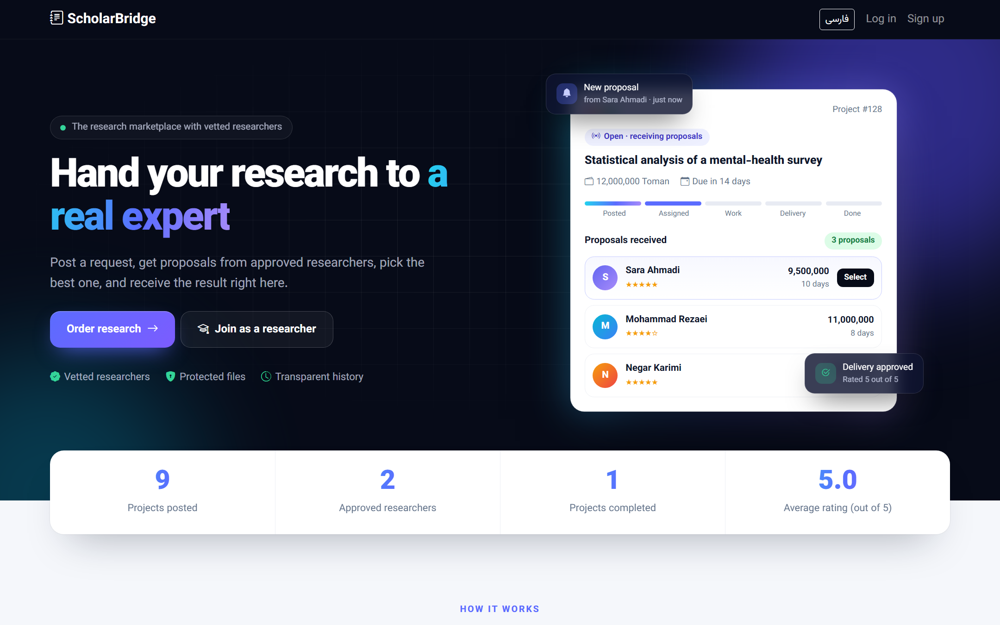
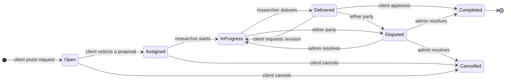
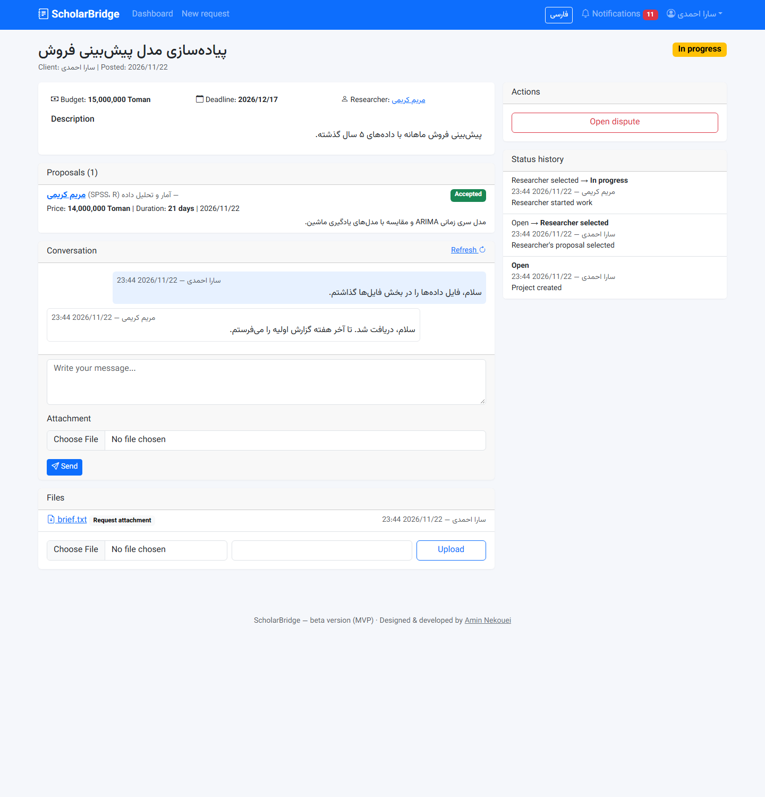
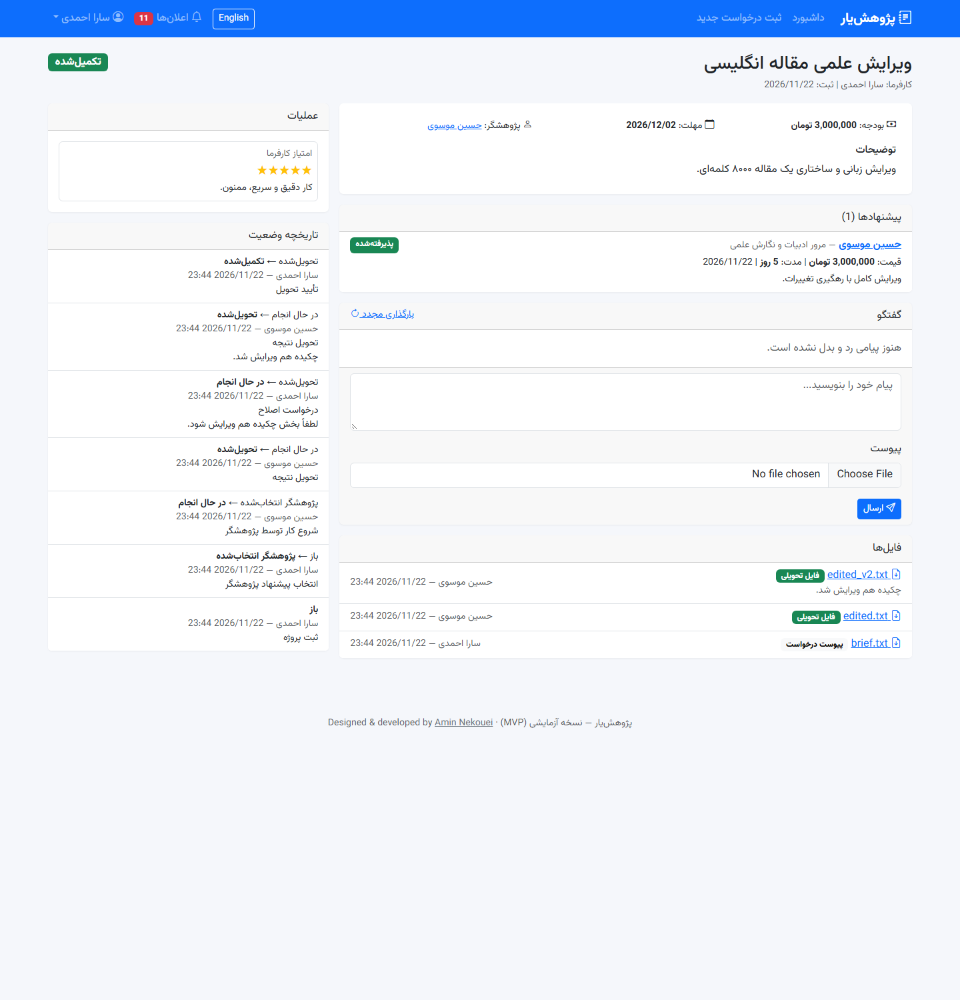
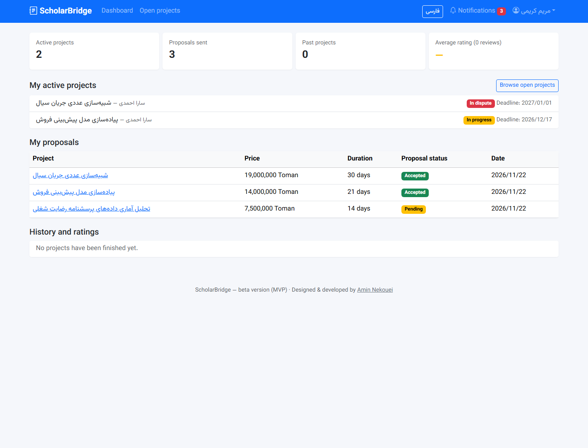
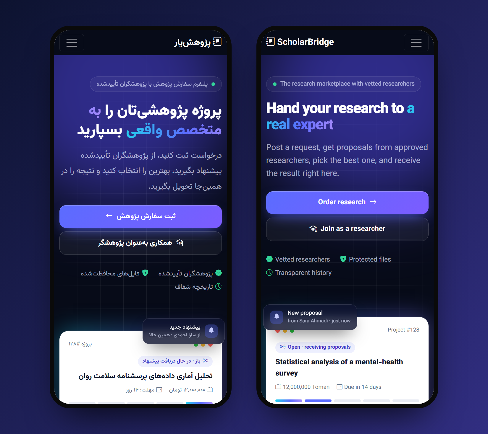
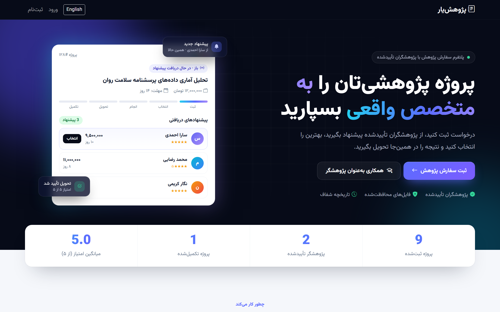
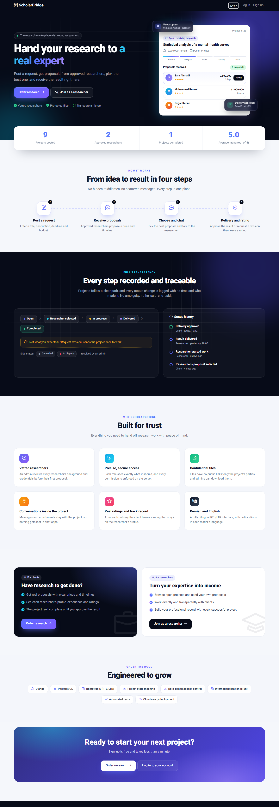
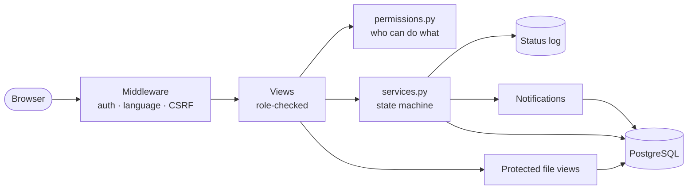

# ScholarBridge · پژوهش‌یار

**A bilingual marketplace that connects people who need research done with vetted researchers.**

Persian-first (RTL) with full English (LTR) support · Built with Django

[**▶ Live demo**](https://researchdesk-beta.onrender.com/) · [LinkedIn](https://www.linkedin.com/in/amin-nekouei) · [GitHub](https://github.com/Amin-nekouei)

> **Note:** This repository is a showcase. The source code is private; contact me on [LinkedIn](https://www.linkedin.com/in/amin-nekouei) if you'd like a walkthrough or access.

---

## Try it

| Role | Username | Password |
|---|---|---|
| Client (posts projects) | `client1` | `demo1234` |
| Researcher (sends proposals) | `researcher1` | `demo1234` |

The demo runs on a free hosting tier, so **the first load can take 30–60 seconds** while the server wakes up. Use the **English / فارسی** button in the top bar to switch languages. Demo data may be reset at any time.

## What it does

Clients post a research request with a description, deadline and budget. Researchers whose profiles an admin has approved send proposals with a price and timeline. The client picks one, and from then on the whole job lives inside the project: messages, files, delivery, revision requests and the final rating.

- **Three roles:** client, researcher and admin. Each sees only what it should, and every permission is checked on the server.
- **Researcher vetting:** a researcher's credentials are reviewed by an admin before they can send a first proposal.
- **Project workspace:** proposals, an in-project conversation with attachments, a file area and an action panel that only offers what the current status allows.
- **Protected files:** uploads have no public URLs. Every download goes through a view that checks the user is a party to the project or an admin.
- **Full audit trail:** every status change is logged with its time and the user who made it.
- **Ratings and track record:** after approving a delivery, the client rates the researcher, and the rating stays on the researcher's profile.
- **In-app notifications:** for proposals, selection, delivery, revisions, disputes and admin actions.
- **Bilingual, both ways:** Persian is the default and English is a full translation. Layout, Bootstrap build and arrows flip between RTL and LTR.

## Project lifecycle

All status changes go through a single state-machine service, so no view can move a project into an invalid state.

## Screenshots

**Project workspace.** Proposals, conversation, files, available actions and status history on one page:

**The same app in Persian (RTL).** A completed project with its full status history and the client's rating:

**Researcher dashboard:**

**Responsive design.** Persian and English on mobile:

<b>Persian landing page and the full English landing page</b>

## Architecture

The project is split into modular Django apps:

| App | Responsibility |
|---|---|
| `accounts` | Custom user model with roles, researcher profiles and admin approval |
| `projects` | Projects, proposals, files, status log, reviews, the state machine and permission rules |
| `messaging` | The per-project conversation, with attachments |
| `notifications` | In-app notifications, stored as translation keys plus parameters |
| `core` | Landing page, role-based dashboards, access decorators, upload validation, demo-data command |

## Engineering notes

- **Business rules live in one place.** Views stay thin. `services.py` owns every transition and `permissions.py` answers "can this user do this, right now?". The UI hides buttons, but the server enforces every rule regardless.
- **Notifications are translated for the reader, not the sender.** Each notification is stored as a translation key and its parameters, not as finished text. A client using English and a researcher using Persian each see the same notification in their own language. Status names inside notifications are translated too.
- **Persian-first i18n.** The source strings are Persian, and English is a gettext catalog of about 370 strings. The default language is set deliberately rather than taken from the browser, and user-written content keeps its own direction (`unicode-bidi: plaintext`) inside the opposite-direction UI.
- **No CDN dependencies.** Bootstrap (RTL and LTR), the icon font and the Vazirmatn typeface are all served by the app itself, so it loads reliably on networks where public CDNs are slow or blocked.
- **Production setup.** It runs on gunicorn with WhiteNoise (compressed, hashed static files) and PostgreSQL through `DATABASE_URL`. It refuses to start without a secret key, uses secure cookies behind the proxy, and is deployed from a Render Blueprint (infrastructure as code). The admin password comes from the environment, never from the repository.
- **Tested.** Automated tests cover role-based access to every page, the full project lifecycle, file-download permissions, a demo-data smoke test and the language behaviour (default language, switching, notifications in the reader's language).

## Tech stack

**Backend:** Python, Django, PostgreSQL (SQLite in development), gunicorn, WhiteNoise
**Frontend:** Django templates, Bootstrap 5 (RTL + LTR), Bootstrap Icons, Vazirmatn, vanilla JS
**i18n:** Django i18n / GNU gettext, Persian + English
**Deployment:** Render (Blueprint, managed PostgreSQL)

## Status

This is an MVP. Payments, email/SMS notifications and real-time chat are intentionally out of scope for this version. The design leaves clear places for them, such as escrow in the select/approve transitions and new delivery channels in the notification service.

---

Designed & developed by **Amin Nekouei** · [LinkedIn](https://www.linkedin.com/in/amin-nekouei) · [GitHub](https://github.com/Amin-nekouei)

